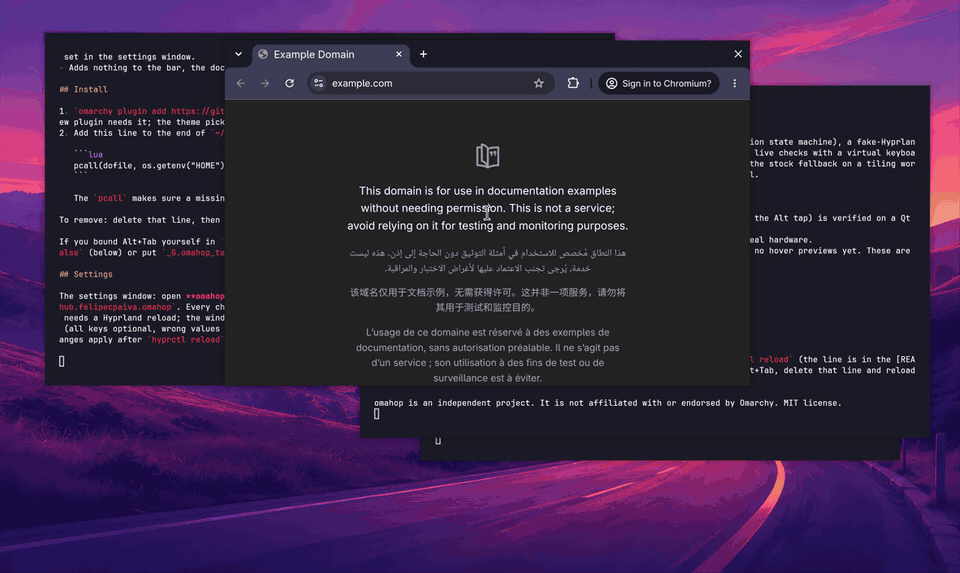
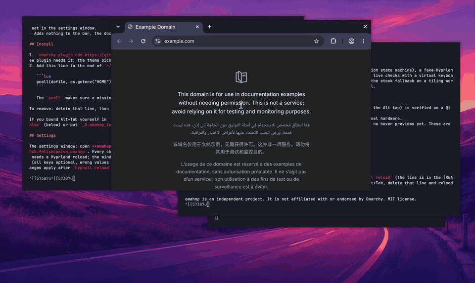
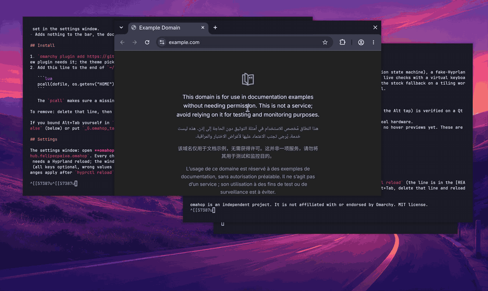

# omahop

Jump to any window fast on Omarchy's floating workspaces. Hold Alt, press Tab: a list of your windows (icon, app name, title) appears in your Omarchy theme. Let go of Alt to switch.

**Status: v0.1.0 released.** The list switcher works. Cards with thumbnails, a settings app and hover previews come in later releases (see `docs/ROADMAP.md`).

## See it








## What it does

- Quick Alt+Tab flips between your last two windows with no overlay. Hold Alt and the list shows after a short delay (default 100 ms).
- Tab and Shift+Tab move through the list (hold Tab to repeat). While you hold Alt: Alt+Escape cancels, Alt+Arrows move, Alt+Return picks.
- The window you pick comes to the front, even when floating windows overlap (focus alone does not raise a floating window; omahop raises it too). A minimized window is brought back to the workspace you are on.
- By default it only takes over Alt+Tab on **floating workspaces**. On tiling workspaces Alt+Tab is exactly the stock Omarchy behaviour.
- **Two looks:** a plain list, or cards with a picture of each window (covered and minimized windows included), set in the settings window.
- Adds nothing to the bar, the dock or the desktop.

## Install

1. `omarchy plugin add https://github.com/felipecpaiva/omahop --enable`, then `omarchy restart shell` once (a new plugin needs it; the theme picker may open, Escape closes it).
2. Add this line to the end of `~/.config/hypr/hyprland.lua`, then `hyprctl reload`:

   ```lua
   pcall(dofile, os.getenv("HOME") .. "/.config/omarchy/plugins/io.github.felipecpaiva.omahop/lua/omahop.lua")
   ```

   The `pcall` makes sure a missing or broken file never breaks the rest of your config.

To remove: delete that line, then `omarchy plugin remove io.github.felipecpaiva.omahop`.

If you bound Alt+Tab yourself in `bindings.lua`, omahop (loaded after it) replaces your bind. Set `takeover = false` (below) or put `_G.omahop_takeover = false` before the load line to leave Alt+Tab alone.

## Settings

The settings window: open **omahop** from the launcher (Super+Space), or run `omarchy-shell shell toggle io.github.felipecpaiva.omahop`. Every change is saved after a moment and applies to the next Alt+Tab (only `takeover` needs a Hyprland reload; the window offers a button). You can also edit `~/.config/omahop/config.toml` by hand (all keys optional, wrong values fall back to the default and are logged to `$XDG_RUNTIME_DIR/omahop/log`). Changes apply after `hyprctl reload`.

```toml
schema = 1
takeover = true          # false: leave Alt+Tab alone
search = true            # type letters while the list is up to filter it
scope = "floating"       # "floating": only on floating workspaces, "all": everywhere
reveal_delay_ms = 100    # a quick tap shows no overlay
style = "list"           # "list" (plain) or "cards" (a picture of each window)
thumbnails = "snapshot"  # cards only: "snapshot" (one picture when it opens), "live" (keeps updating, uses CPU), "off" (icons only)
border = "auto"          # the list's outline: "auto" follows Hyprland's window border (none when you turned window borders off), "on", "off"

[windows]
workspaces = "floating"  # which workspaces' windows are listed: "current", "floating", "all"
monitors = "active"      # "active" (the monitor with focus) or "all"
minimized = "back"       # "back": listed last, "hide"
specials = "hide"        # "show": scratchpad and other special workspaces
ignore = ""              # window classes to never list, comma separated

[keys]
repeat_delay_ms = 250    # holding Tab: wait, then repeat
repeat_ms = 40
```

The full model and every combination: `docs/settings.md`.

## Known limits (v0.1)

- Alt+Tab with other keys held (for example Ctrl+Alt+Tab) is not touched.
- The Alt-menu fix (an injected F24 key so apps do not open their menu bar on the Alt tap) is verified on a Qt app only; GTK, Chromium and Electron are on the hand-check list (`docs/validation-checklist.md`).
- No thumbnails yet and no hover previews (planned).

## Develop

`bash tests/run-all.sh --no-live` runs the unit, glue and scrub checks (Lua 5.5, Node). `bash tests/run-all.sh` adds the live test that drives the real keyboard through `/dev/uinput` on a spare workspace (keep your hands off the keyboard for about a minute). Design, decisions, research and the roadmap are in `docs/`, start at `docs/architecture.md`.

Rules for all code: `docs/engineering-standards.md`. Sister project: [omagnet](https://github.com/felipecpaiva/omagnet) (window snapping for floating workspaces).

License: MIT.
