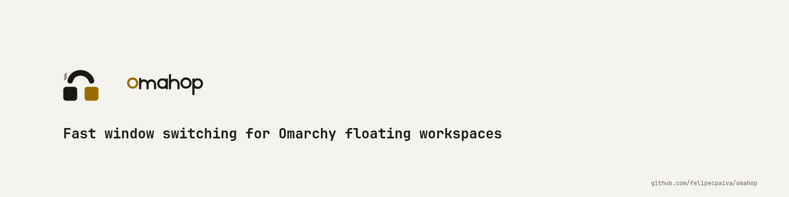
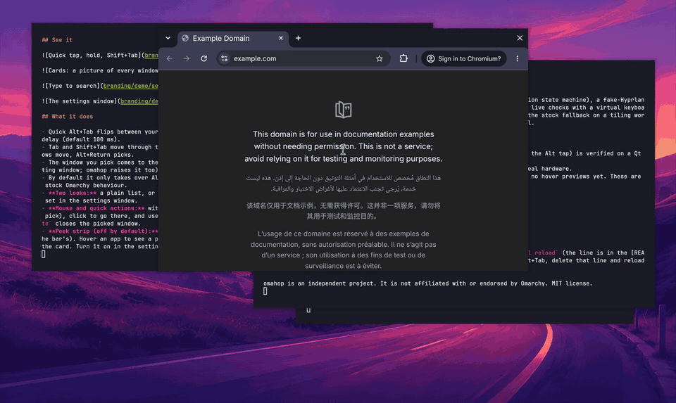
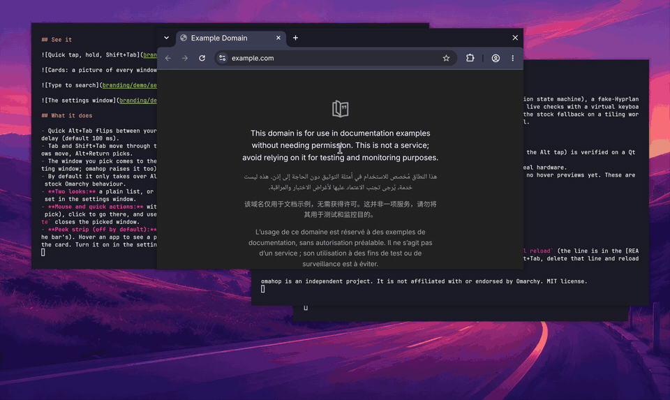
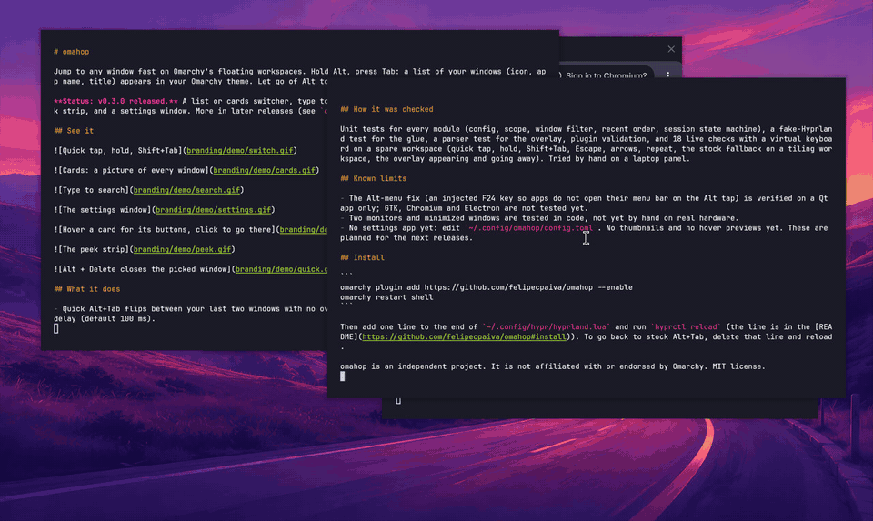
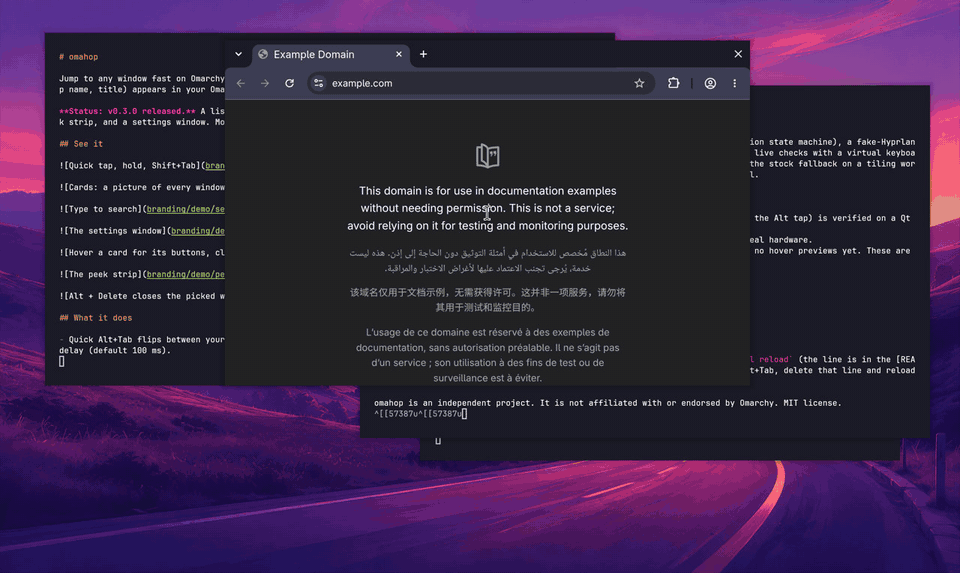

<p align="center">
  <picture>
    <source media="(prefers-color-scheme: dark)" srcset="branding/social/banner-dark.png">
    
  </picture>
</p>

<p align="center"></p>

# omahop

Jump to any window fast on Omarchy's floating workspaces. Hold Alt, press Tab: a list of your windows (icon, app name, title) appears in your Omarchy theme. Let go of Alt to switch. Prefer Ctrl? The `modifier` setting changes the key you hold (Alt everywhere below means that key).

**Status: v1.3.1 released.** A list or cards switcher, type to search (accents ignored, fuzzy, optionally kept open), mouse and quick actions, an optional peek strip, a same-app shortcut, app rules, quick jump keys, icon theme, icon packs, quit and minimize by key, a choice of held key, and thumbnail exclusions, and a settings window. More in later releases (see `docs/ROADMAP.md`).

## See it











## What it does

- Quick Alt+Tab flips between your last two windows with no overlay. Hold Alt and the list shows after a short delay (default 100 ms).
- Tab and Shift+Tab move through the list (hold Tab to repeat). While you hold Alt: Alt+Escape cancels, Alt+Arrows move, Alt+Return picks.
- The window you pick comes to the front, even when floating windows overlap (focus alone does not raise a floating window; omahop raises it too). A minimized window is brought back to the workspace you are on.
- By default it only takes over Alt+Tab on **floating workspaces**. On tiling workspaces Alt+Tab is exactly the stock Omarchy behaviour.
- **Two looks:** a plain list, or cards with a picture of each window (covered and minimized windows included), set in the settings window.
- **Mouse and quick actions:** with the list or cards up, hover a row (a light highlight, it never changes your pick), click to go there, and use the buttons on the hovered row to close or minimize that window. `Alt + Delete` closes the picked window.
- **Peek strip (off by default):** a slim row of your running apps on a free screen edge (not the dock's, not the bar's). Hover an app to see a picture of each of its windows, click one to go there, close or minimize from the card. Turn it on in the settings (Peek strip): at the screen edge, or always visible.
- **Same-app shortcut:** `Alt + backtick` lists only the windows of the app you are in (like Cmd+backtick on a Mac). It is bound after Hyprland has loaded and never takes a chord you already use.
- **App rules:** never list windows by title fragment, list some apps first, and step aside (stock Alt+Tab) for fullscreen apps or named apps such as games and remote desktops.
- **Keep the list open while searching (off by default):** with `search_linger_seconds` from 1 to 60, once you have typed a search, releasing Alt no longer picks. The list stays open that many seconds after your last key and takes the keyboard, so any character can be typed (capitals, accents). Return picks, Escape clears the search and then closes, a click outside the list closes it, and when the time runs out it closes without picking. With 0 (the default) releasing Alt picks, as before.
- **Icon packs (off by default):** give apps your own icons with a hand-made pack folder (`pack.toml` plus `icons/<app>.svg` or `.png`) in `~/.config/omahop/packs/`, then set Icon pack in the settings. Files are checked before use and nothing in a pack is run. Share a pack as one zip with `tools/pack-export.sh` and install one with `tools/pack-import.sh`, which checks the zip before unpacking anything. Format, sharing and a sample pack: [docs/icon-packs.md](docs/icon-packs.md).
- **Quick jump keys:** number keys (`Alt + 1` to `9`) or letters you map to apps jump straight to a window; any other key still types into the search.
- **Quit and minimize by key:** set `action_keys = "q=close, m=minimize"` and, with the list up and nothing typed yet, that key closes or minimizes the selected window and the selection moves to the next row. Once you type a letter, every key types. Off by default; a key a hint already uses is left to the hint. Needs `Type to search` on, because it rides the same keys.
- Adds nothing to the bar, the dock or the desktop unless you turn the peek strip on.

## Browser tabs (optional)

Off by default, and new in v1.4 (in progress). With "Search browser tabs" on in the settings window, a search also finds the tabs behind other tabs in your browser windows: each matching tab is a compact row under its window (with the browser's own icon, its title and its site), and Return opens that tab and brings its window to the front. Tab rows only appear once you type, so Alt+Tab itself works exactly as before.

It needs a small browser extension and a helper program that live in a separate repository, `omahop-tabs` (private for now), with their own install and removal notes. Chromium browsers first (Chrome, Chromium, Brave, Edge). omahop itself installs nothing for it.

Privacy: tab titles and addresses are private, so they stay on this computer. The helper writes them only while the setting is on, to a temporary folder (`$XDG_RUNTIME_DIR/omahop`, mode 700, emptied at logout); turning the setting off removes them. omahop reads them only when you type into the switcher, keeps only the title and the site name (never the rest of the address) for the open list, and never writes them to its log. Sites you list under "Never list tabs from these sites" (`browser_tabs_ignore`, for example a bank) are dropped by the helper before anything is written, and again by omahop. Details: [docs/file-contract.md](docs/file-contract.md).

## Requirements and what it touches

- Omarchy 4.5 or newer (the Hyprland Lua configuration and the Quickshell shell it ships). Nothing else to install: no network, no root, no packages.
- It reads the list of windows (class, title, workspace, monitor) from Hyprland, and takes screenshots of windows through Wayland's screen-capture protocol only to draw thumbnails (nothing is saved or sent anywhere).
- It writes small state files under `$XDG_RUNTIME_DIR/omahop` (gone at logout), its settings at `~/.config/omahop/config.toml`, and a launcher entry `~/.local/share/applications/omahop.desktop` (only one that carries its own marker is ever replaced or removed). It never edits your `hyprland.lua` or any Omarchy file.
- Keys it takes: Alt+Tab and Alt+Shift+Tab (where it is active), the same-app chord, and Alt plus letters, digits, Delete, Escape, Return and the arrows only while the list is up, and never a chord you already use. With `modifier` set to Super or Ctrl, the same keys with that modifier instead, and Super+Tab or Ctrl+Tab is only taken when no bind of yours or Omarchy's uses it.

## Install

1. `omarchy plugin add https://github.com/felipecpaiva/omahop --enable`, then `omarchy restart shell` once (a new plugin needs it; the theme picker may open, Escape closes it).
2. Add this line to the end of `~/.config/hypr/hyprland.lua`, then `hyprctl reload`:

   ```lua
   pcall(dofile, os.getenv("HOME") .. "/.config/omarchy/plugins/io.github.felipecpaiva.omahop/lua/omahop.lua")
   ```

   The `pcall` makes sure a missing or broken file never breaks the rest of your config.

To remove: delete that line, then `omarchy plugin remove io.github.felipecpaiva.omahop`.

If you bound Alt+Tab yourself in `bindings.lua`, omahop (loaded after it) replaces your bind. Set `takeover = false` (below) or put `_G.omahop_takeover = false` before the load line to leave Alt+Tab alone.

## Settings

The settings window: open **omahop** from the launcher (Super+Space), or run `omarchy-shell shell toggle io.github.felipecpaiva.omahop`. Every change is saved after a moment and applies to the next Alt+Tab (only `takeover`, `modifier` and the same-app shortcut need a Hyprland reload; the window offers a button). You can also edit `~/.config/omahop/config.toml` by hand (all keys optional, wrong values fall back to the default and are logged to `$XDG_RUNTIME_DIR/omahop/log`). Changes apply after `hyprctl reload`.

```toml
schema = 1
takeover = true          # false: leave Alt+Tab alone
modifier = "alt"         # the key you hold: "alt" or "ctrl" (needs a Hyprland reload; see "Choosing the key to hold")
search = true            # type letters while the list is up to filter it
search_fuzzy = true      # also match initials (gc: Google Chrome) and letters in order inside a word (chrm: chrome)
search_linger_seconds = 0  # 1 to 60: after typing, releasing Alt keeps the list open this long (Return picks); 0 picks on release
scope = "floating"       # "floating": only on floating workspaces, "all": everywhere
reveal_delay_ms = 100    # a quick tap shows no overlay
style = "list"           # "list" (plain) or "cards" (a picture of each window)
thumbnails = "snapshot"  # cards only: "snapshot" (one picture when it opens), "live" (keeps updating, uses CPU), "off" (icons only)
thumbnail_exclude = ""   # window classes never captured into a picture, comma separated (password manager, bank): they show the app icon
actions = true           # close and minimize buttons on the hovered row or card
same_app_key = "ALT + GRAVE"  # the same-app shortcut ("" turns it off, needs a Hyprland reload)
hints = "off"            # quick jump keys: "off", "numbers", "apps" (with hint_keys = "c=google-chrome, t=kitty")
action_keys = ""         # keys that act on the selected window while nothing is typed: "q=close, m=minimize" (empty: off)
passthrough_fullscreen = false  # true: stock Alt+Tab while the focused window is fullscreen
peek = "off"             # the peek strip: "off", "edge" (shows when the pointer touches the screen edge), "always"
peek_position = "auto"   # "auto" (a free edge), "bottom", "top", "left", "right"
border = "auto"          # the list's outline: "auto" follows Hyprland's window border (none when you turned window borders off), "on", "off"
icon_theme = ""         # an installed icon theme to prefer, by folder name (for example "Papirus"); "" = none. Applies at once
icon_pack = ""          # your own icons: a folder name under ~/.config/omahop/packs (format in docs/icon-packs.md); "" = none

[windows]
workspaces = "floating"  # which workspaces' windows are listed: "current", "floating", "all"
monitors = "active"      # "active" (the monitor with focus) or "all"
minimized = "back"       # "back": listed last, "hide"
specials = "hide"        # "show": scratchpad and other special workspaces
ignore = ""              # window classes to never list, comma separated
ignore_titles = ""       # never list windows whose title contains one of these fragments
first = ""               # apps to list first (window classes)

[keys]
repeat_delay_ms = 250    # holding Tab: wait, then repeat
repeat_ms = 40
```

The full model and every combination: `docs/settings.md`.

### Choosing the key to hold

`modifier = "alt"` (the default) replaces Omarchy's own Alt+Tab, and on workspaces where omahop is not active it runs Omarchy's Alt+Tab itself, as before.

- Super is not offered: Omarchy owns Super+Tab (next workspace) and most other Super chords, so omahop never touches them. Ctrl+Alt is not an option either: Omarchy binds Ctrl+Alt+Tab (focus next monitor).
- `"ctrl"`: Ctrl+Tab is free in Hyprland, so omahop takes it, but apps use it (tab switching in browsers and editors): where omahop is active, Ctrl+Tab opens omahop instead. Where it is not active, the key is handed back to the app.
- The same-app shortcut must start with the same key (`same_app_key = "CTRL + GRAVE"` with Ctrl); the default `ALT + GRAVE` is skipped otherwise, with a note in the log.
- Shift is not offered: it already means "go back" (Shift+Tab) and types capitals.

## Known limits (v0.1)

- Alt+Tab with other keys held (for example Ctrl+Alt+Tab) is not touched.
- The Alt-menu fix (an injected F24 key so apps do not open their menu bar on the Alt tap) is verified on a Qt app only; GTK, Chromium and Electron are on the hand-check list (`docs/validation-checklist.md`).
- No thumbnails yet and no hover previews (planned).

## Develop

`bash tests/run-all.sh --no-live` runs the unit, glue and scrub checks (Lua 5.5, Node). `bash tests/run-all.sh` adds the live test that drives the real keyboard through `/dev/uinput` on a spare workspace (keep your hands off the keyboard and mouse for about ten minutes). `lua/test_monitors.lua` models 1 to 6 monitors (every focus, every setting, unplugging) with no hardware, and `tests/live_monitors.py` checks every monitor you have attached, from each one in turn (it skips itself with one monitor). Design, decisions, research and the roadmap are in `docs/`, start at `docs/architecture.md`.

Rules for all code: `docs/engineering-standards.md`. Sister project: [omagnet](https://github.com/felipecpaiva/omagnet) (window snapping for floating workspaces).

License: MIT.
