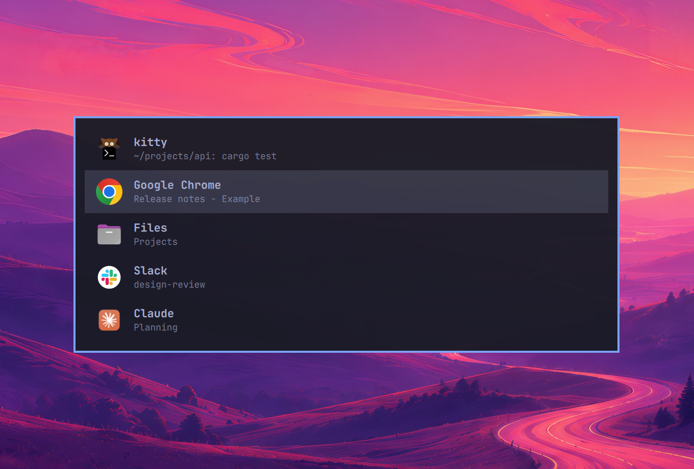

Hold Alt, press Tab, and see your windows in a list that matches your Omarchy theme. Let go of Alt to jump to the one you picked. Made for Omarchy's floating workspaces.



## What is new (first release)

- **A list switcher.** One row per window: app icon, app name, window title. The picked row is highlighted. It follows your Omarchy theme live, uses your corner rounding, and drops its outline when you turned window borders off (setting `border`, default `auto`).
- **Quick tap flips between your last two windows** with no overlay. Hold Alt and the list appears after a short delay (`reveal_delay_ms`, default 100, 0 shows it at once).
- **Keys:** Tab and Shift+Tab move (hold Tab to repeat), Alt+Arrows move, Alt+Return picks, Alt+Escape cancels.
- **The window you pick comes to the front**, also when floating windows overlap (a plain focus does not raise a floating window; omahop raises it as well). A minimized window is brought back to the workspace you are on.
- **Only on floating workspaces by default.** Tiling workspaces keep the stock Omarchy Alt+Tab. Settings let you widen it (`scope`) and choose which windows are listed: this workspace, floating workspaces or all, the active monitor or all, minimized and scratchpad windows, an ignore list.
- **Adds nothing to your bar, dock or desktop.**

## How it was checked

Unit tests for every module (config, scope, window filter, recent order, session state machine), a fake-Hyprland test for the glue, a parser test for the overlay, plugin validation, and 18 live checks with a virtual keyboard on a spare workspace (quick tap, hold, Shift+Tab, Escape, arrows, repeat, the stock fallback on a tiling workspace, the overlay appearing and going away). Tried by hand on a laptop panel.

## Known limits

- The Alt-menu fix (an injected F24 key so apps do not open their menu bar on the Alt tap) is verified on a Qt app only; GTK, Chromium and Electron are not tested yet.
- Two monitors and minimized windows are tested in code, not yet by hand on real hardware.
- No settings app yet: edit `~/.config/omahop/config.toml`. No thumbnails and no hover previews yet. These are planned for the next releases.

## Install

```
omarchy plugin add https://github.com/felipecpaiva/omahop --enable
omarchy restart shell
```

Then add one line to the end of `~/.config/hypr/hyprland.lua` and run `hyprctl reload` (the line is in the [README](https://github.com/felipecpaiva/omahop#install)). To go back to stock Alt+Tab, delete that line and reload.

omahop is an independent project. It is not affiliated with or endorsed by Omarchy. MIT license.
