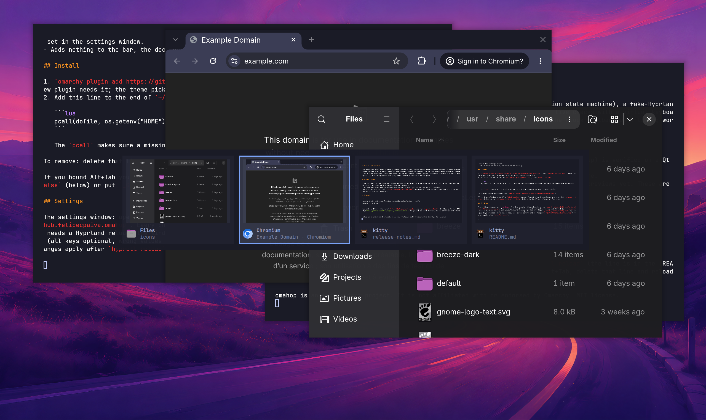
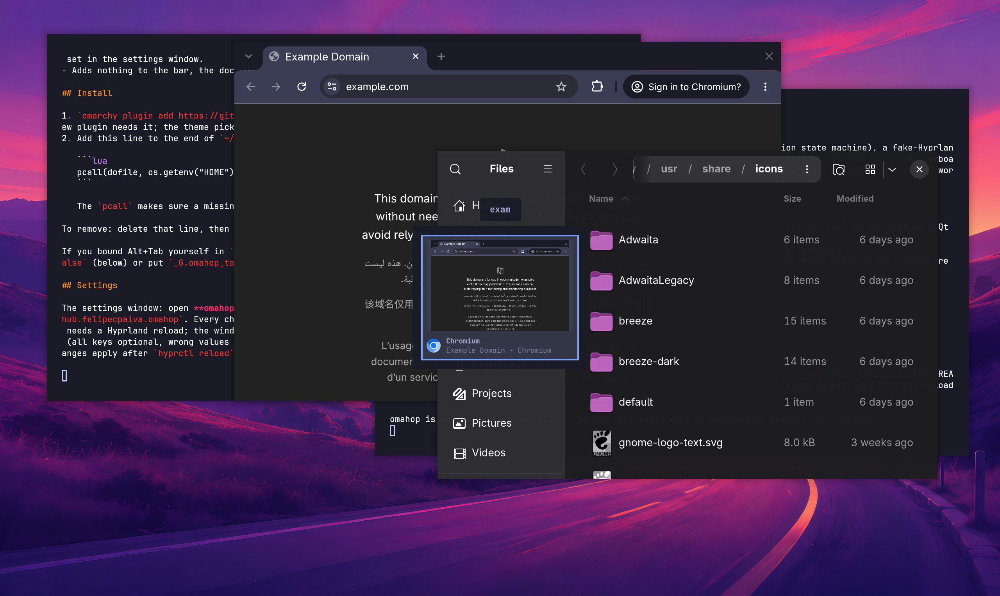
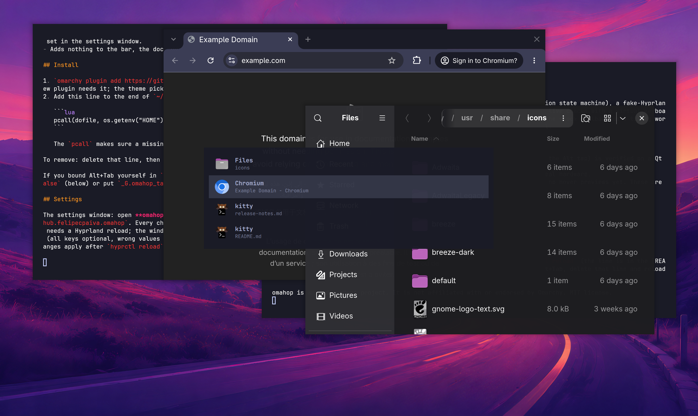
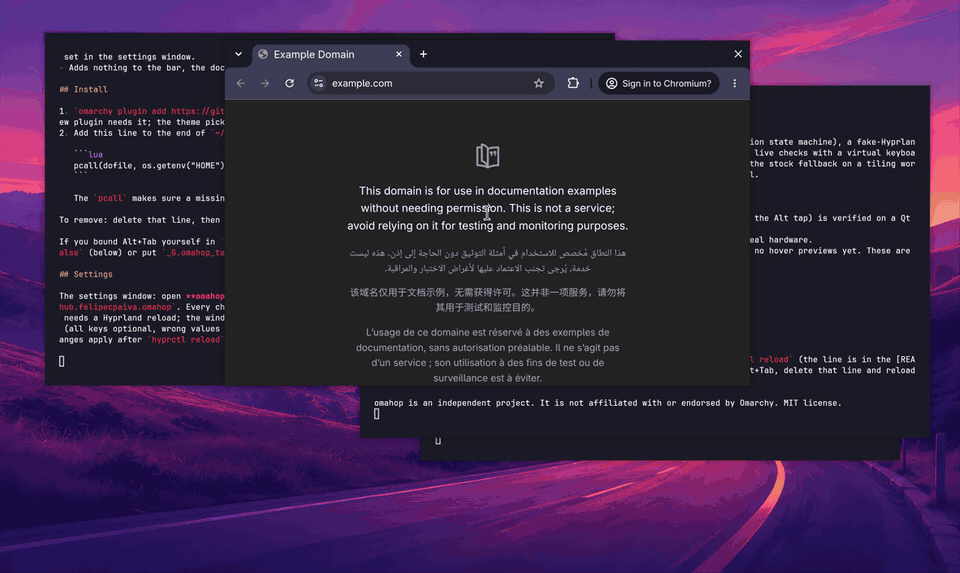
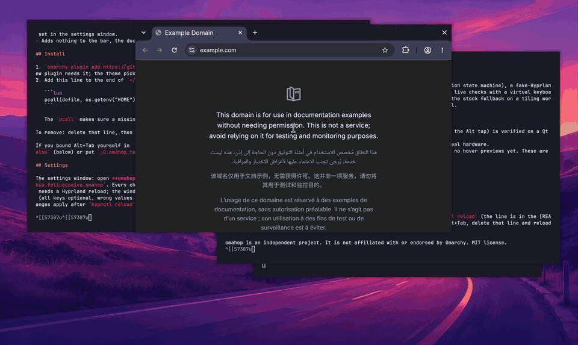
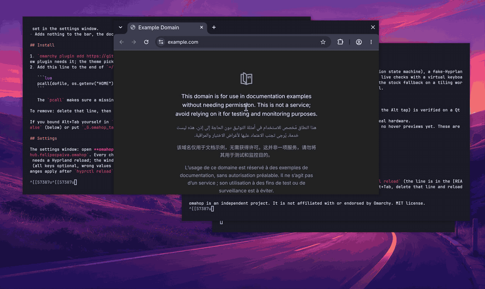

A settings window, cards with a picture of each window, and type to search. Everything from v0.1.0 still works the same.

## What is new

- **Cards style.** A strip of cards with a picture of each window, its icon, app name and title. Windows covered by other windows, on other floating workspaces, and minimized ones all show their own picture. The picked card has the accent outline and the strip scrolls with many windows. Pick it in the settings, or `style = "cards"`.
- **Thumbnails you can tune.** `snapshot` (the default) takes one picture of each window when the cards open and costs almost nothing. `live` keeps them updating and uses real CPU with many windows (we measured about 20% of Hyprland for 30 live views). `off` shows icons only.
- **Type to search.** Hold Alt, press Tab, then type: the list keeps only windows whose app name, class or title match every word you typed (typing "files" finds the file manager). Backspace deletes, the first Escape clears what you typed, releasing Alt goes to the best match. Letters are only taken while Alt is held, never for a shortcut you bound yourself.

- **A settings window.** Open **omahop** from the launcher or run `omarchy-shell shell toggle io.github.felipecpaiva.omahop`. One page, grouped, in your Omarchy theme: take over Alt+Tab, where, type to search, which windows are listed, style, thumbnails, outline, delay, key repeat. Every change is saved after a moment and applies to the next Alt+Tab, with no reload (only "Take over Alt+Tab" needs one, and the window has a button for it). Your own comments and extra lines in `config.toml` are never lost: a change edits one line.
- **The plain list is still there** and still the default.

## See it

## Fixed

- A `#` inside a quoted setting (for example an ignore list) no longer cuts the line, in both the Lua and the settings parsers.

## How it was checked

Unit tests for every module, a fake-Hyprland test for the glue (typed keys, a bind of your own left alone, search off), a Lua and JavaScript parser cross-check, plugin validation, and live tests on a real session: 24 checks with a virtual keyboard (quick tap, hold, Shift+Tab, Escape, arrows, repeat, search, the stock fallback on a tiling workspace), a virtual mouse clicking the settings window and a check of the file it writes, and a screenshot check that the cards show a picture for a covered window, a minimized window and the top window.

## Known limits

- Cards are keyboard only (hover and click come later).
- Search matches app names the overlay has resolved from desktop entries, window classes and titles; a very long list of windows is not ranked beyond "starts with".
- The Alt-menu fix is verified on a Qt app only; GTK, Chromium and Electron are on the hand-check list. Two monitors and unplugging a monitor are tested in code, not by hand on real hardware.

## Update

`omarchy plugin update io.github.felipecpaiva.omahop`, then `omarchy restart shell` (the new settings window needs it). Your `config.toml` keeps working; new settings are optional.

omahop is an independent project. It is not affiliated with or endorsed by Omarchy. MIT license.
