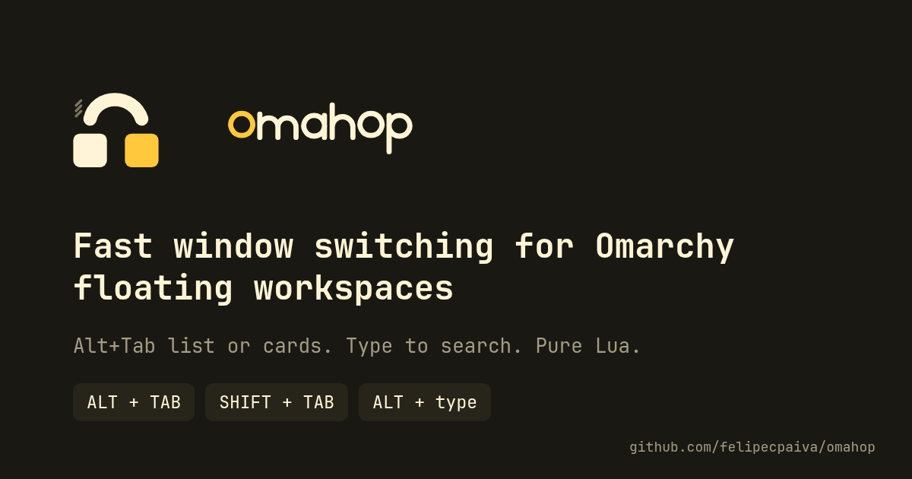
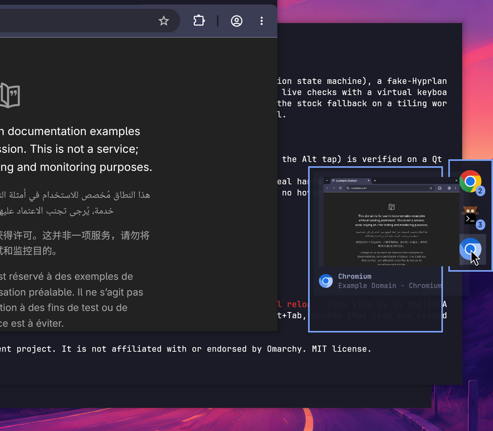
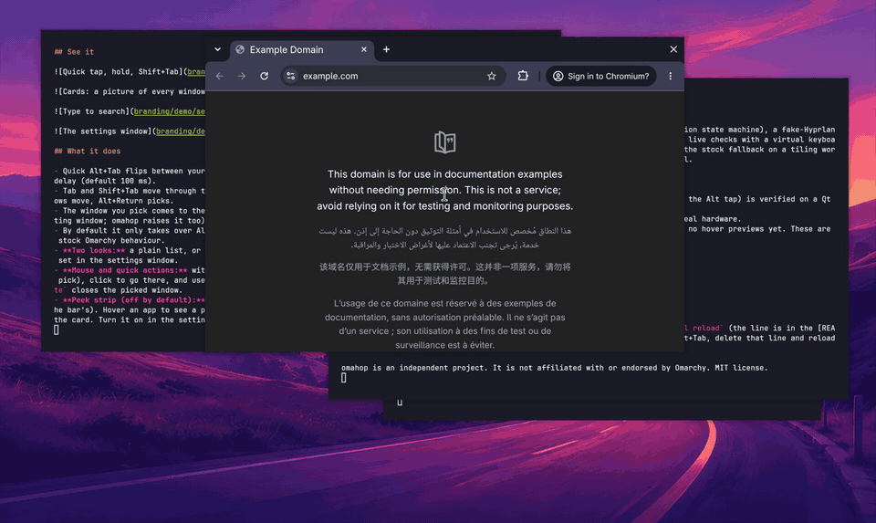
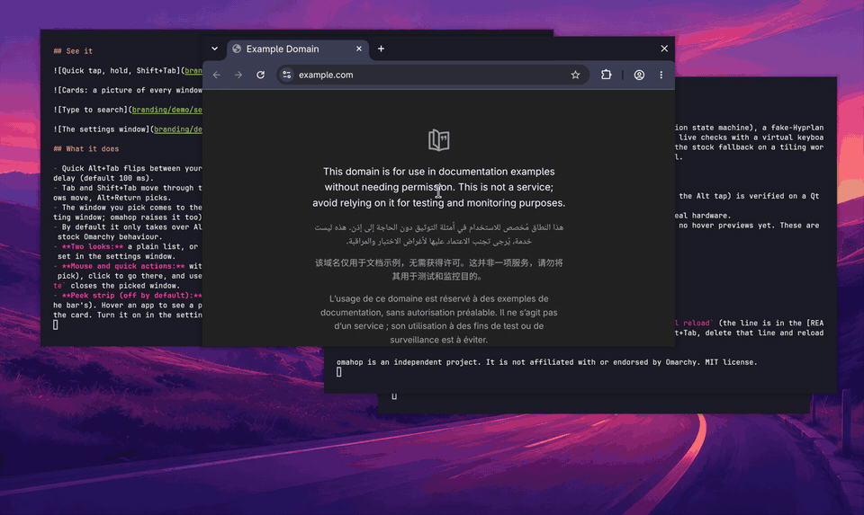

Use the mouse on the switcher, close windows from it, and an optional peek strip of your apps with a picture of each window on hover. Everything from v0.2.0 still works the same.

## What is new

- **Mouse on the switcher.** With the list or cards up, hover a row or card (a light highlight; it never changes your keyboard pick, so a pointer resting where the list opens does nothing) and click to go to that window.
- **Quick actions.** Close and minimize buttons appear on the hovered row or card. `Alt + Delete` closes the picked window. Closing is a request (the app may ask first), so the row leaves the list when the window is really gone. Buttons can be turned off in the settings.
- **Peek strip, off by default.** A slim row of your running apps on a screen edge, with a count when an app has several windows. Hover an app to see a picture of each of its windows, click one to go there, close or minimize from the card. Two modes: show when the pointer touches the edge, or always visible. By default it takes a free edge (not the dock's and not the bar's); you can choose any edge. It adds nothing to your desktop unless you turn it on.

## Why the peek strip is its own thing

Omarchy's dock cannot be extended by a plugin: a third-party plugin can only reach its own service, and the dock's icon positions cannot be rebuilt from outside. So omahop draws its own optional strip instead of reaching into the dock. Hover previews on the stock dock itself are being worked on in Omarchy (pull requests 16219 and 16479).

## How it was checked

Unit tests for every module (a new pure model for the strip), a fake-Hyprland test for the new entry points including malicious-looking input (only plain hex addresses and integers get through), and live tests on a real session with a virtual keyboard and mouse: 42 checks. They include: hovering changes neither the focus nor the selection, a click picks, the close button closes and the row leaves the list, `Alt + Delete` closes, the strip adds no layer when it is off, shows a slot per app, a hover shows a card per window, a click goes to the window, and the edge mode hides until the pointer touches the edge. omagnet's own live suite passes with the peek strip on.

## Known limits

- Minimize from a card works on floating workspaces only (it uses Omarchy's own minimize); not covered by the automated tests, on the hand-check list.
- Two monitors and unplugging a monitor are not tested on real hardware.
- The Alt-menu fix is verified on a Qt app only.
- The strip lists windows on floating workspaces; apps without an icon theme entry show a generic icon.

## Update

`omarchy plugin update io.github.felipecpaiva.omahop`, then `omarchy restart shell` (new QML needs it). Your `config.toml` keeps working; the peek strip and the buttons are new optional settings.

omahop is an independent project. It is not affiliated with or endorsed by Omarchy. MIT license.
