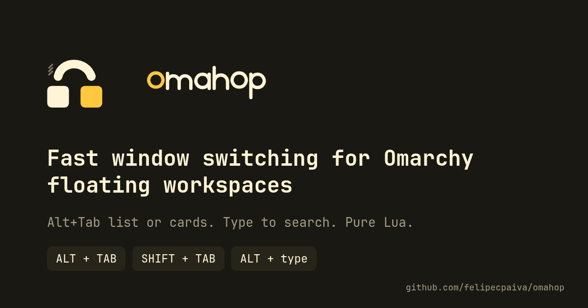
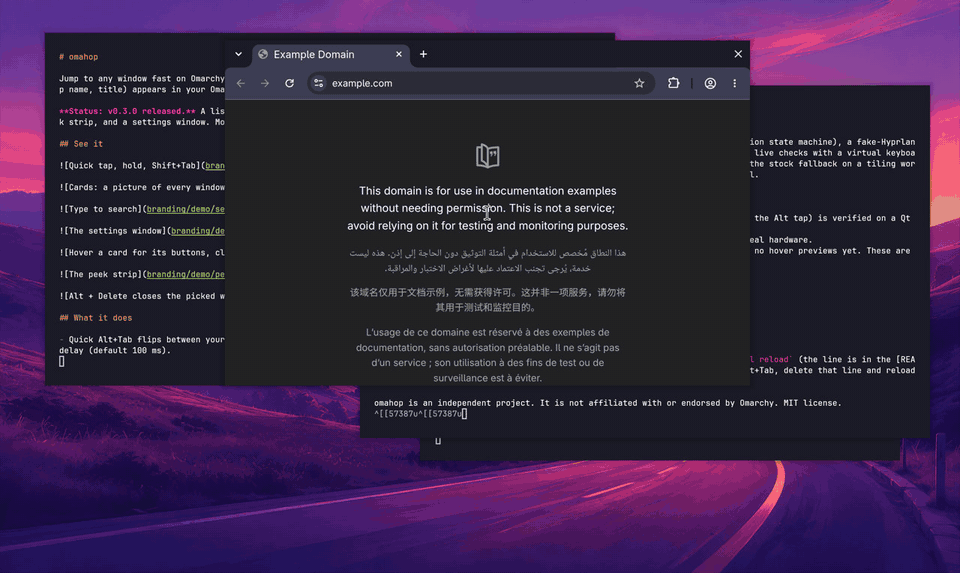
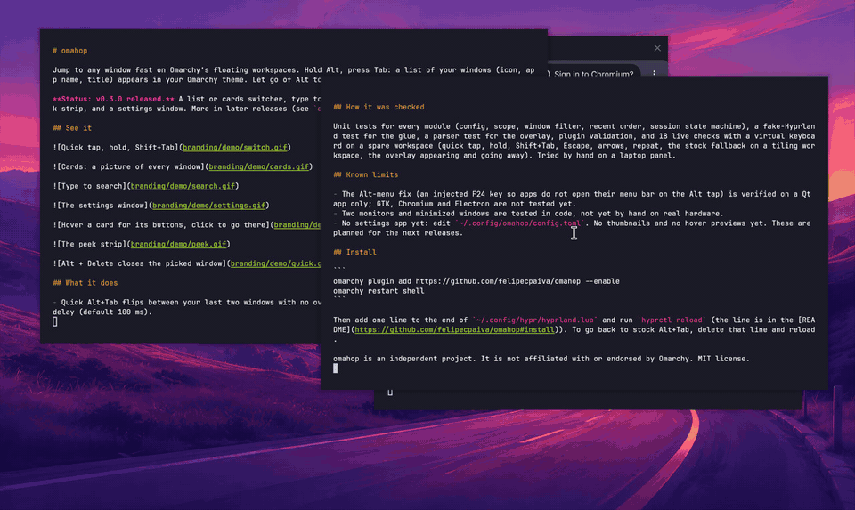

A same-app shortcut, app rules, and quick jump keys. Everything from v0.3.0 still works the same.

## What is new

- **Same-app shortcut.** `Alt + backtick` (the key above Tab) lists only the windows of the app you are in, like Cmd+backtick on a Mac, with the same overlay and keys. The first press goes to that app's previous window. It is bound after Hyprland has loaded and never takes a chord you already use. Where omahop is not active, the key still reaches your app. Change or turn it off with the `same_app_key` setting (an `ALT + key` chord, empty for off; it applies after a Hyprland reload).

- **App rules** (new group in the settings window): never list windows whose title contains a fragment (for example "picture in picture"), list chosen apps first, and **step aside** for fullscreen apps or named apps (games, remote desktops, virtual machines): Alt+Tab then works exactly as Omarchy has it.
- **Quick jump keys.** With the list up and nothing typed yet, `Alt + 1` to `9` pick that row, or letters you map to apps (`c=google-chrome, t=kitty`) pick that app's most recent window. Small chips on the rows show the keys. Any key that is not a hint still types into the search, and once you have typed something, every key types: search never breaks. Off by default.

## Changed

- The state file between the Lua side and the overlay now carries a hint per window (a format change inside the plugin; both sides ship together).

## How it was checked

Unit tests for the new modules (rules, hints), the glue (a chord you already use is left alone, only ALT chords are accepted, the key is handed back out of scope, a number with no such row types instead), and live tests with a virtual keyboard on a real session: ignore by title, apps first, pass-through for a real fullscreen window and for a named app, the same-app list with two windows of one app, number and letter hints, and that digits type when hints are off. The earlier suites (switcher, settings window, cards, pointer, peek strip) pass too.

## Known limits

- Hints need the `hints` setting turned on; the same-app shortcut needs a Hyprland reload to change.
- Letters mapped as hints cannot start a search query (use a different first letter or turn hints off).
- Your own profiles with different settings per shortcut are not built; the same-app shortcut is the one extra profile.
- Two monitors, unplugging a monitor, minimize from a card, and non-Qt apps for the Alt-menu fix are still on the hand-check list.

## Update

`omarchy plugin update io.github.felipecpaiva.omahop`, then `omarchy restart shell` and `hyprctl reload` (new binds and new QML). Your `config.toml` keeps working; all new settings are optional.

omahop is an independent project. It is not affiliated with or endorsed by Omarchy. MIT license.
