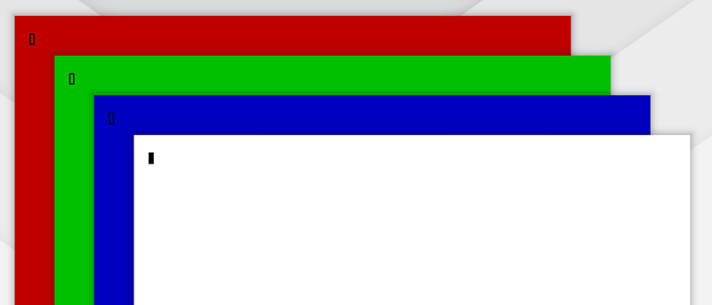

# omahop v1.1.0

Search got smarter, icons follow your theme, and you choose which apps are never captured.

The picture above shows the new search: accents are ignored, and fuzzy matching finds a window by the first letters of its words.

What is new:

- **Search ignores accents and can match initials.** `acao` finds "Ação". `rncf` finds "Reunião de Café". Turn the fuzzy part off with `search_fuzzy = false`.
- **`icon_theme` setting.** Name an icon theme and the switcher prefers its icons. The scan runs again when you change the value. An empty value keeps the system theme.
- **`thumbnail_exclude` setting.** List app classes that are never captured (for example a password manager). Their cards and peek tiles show the app icon only.

All three settings are in the settings window. Nothing new is added to your bar or desktop.

What was tested: unit and glue tests for the new search, the icon index and the exclusions, plus the full live suite (73 checks, no failures). The monitor live test needs two screens and was skipped on this run; the model covers 1 to 6 monitors.

Next ideas (not promised): keep the list open while you search, a modifier setting, quit and minimize by key, icon packs. See `docs/ROADMAP.md`.
