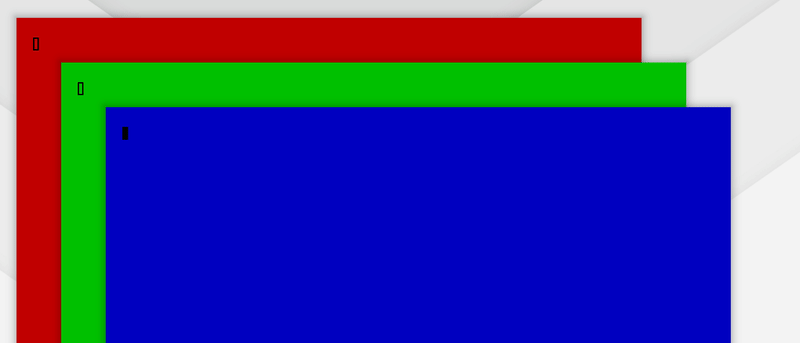

# omahop v1.2.0

Keep the list open while you search. Type, let go of every key, and keep typing. No more keyboard gymnastics.

The gif shows it: Alt+Tab, type `br`, release Alt, wait three seconds, type `a`, press Return. The thin line under the search box is the countdown.

What is new:

- **`search_linger_seconds` setting.** Default 0, which keeps today's behaviour. Set 1 to 60 and, once you typed a search, releasing Alt no longer picks. The list stays open for that many seconds after your last key. Return picks. Escape clears the search, then closes. A click outside the card closes. When the time runs out the list closes and picks nothing.
- **Any character can be typed**, including capitals and accents, because the list takes the keyboard while it waits.
- **Behaviour change when on:** with this setting on, "type, release Alt" no longer picks by itself. Press Return. The setting text says so.

Good to know: while the list waits, it takes your keys. If you change your mind and type into the app below, the first keys go into the search. Press Escape or click outside to give the keys back.

What was tested: unit and glue tests, a new live test with five scenarios (pick after Alt up 5 of 5 times, timeout, Escape twice, click outside, reload while waiting), and the full live suite (96 checks, no failures). Two monitors with the keyboard grab is a hand check and is not tested.

Next ideas (not promised): a modifier setting, quit and minimize by key, icon packs, browser tab search. See `docs/ROADMAP.md`.
