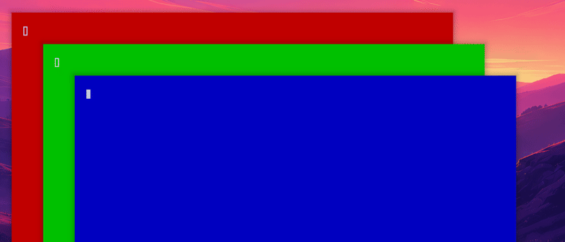

# omahop v1.3.0

Three new settings: choose the key you hold, quit or minimize by key, and hand-made icon packs.

The gif shows quit and minimize by key: Alt+Tab, press `q` to close the selected window, press `m` to minimize one, then release Alt to pick the next row.

What is new:

- **`action_keys` setting.** Default empty (off). Write pairs like `q=close, m=minimize`. While the list is up and nothing is typed, that key acts on the selected window and the selection moves to the next row. Once you type a letter, the key types into the search as before. A key that a quick jump hint uses is skipped, and the hint wins.
- **`modifier` setting.** `alt` (default), `super` or `ctrl`. This is the key you hold for the switch. It needs a Hyprland reload. Ctrl+Tab works out of the box. Super+Tab is Omarchy's own next-workspace key, so omahop leaves it alone and logs why until you free it.
- **`icon_pack` setting.** Put a folder in `~/.config/omahop/packs/<name>/` with a `pack.toml` and an `icons/` folder, name the pack in the setting, and its icons come before the theme icons. Packs are checked strictly (only PNG and SVG, size limits, no scripts, no links out of the folder). The format and a sample pack are in `docs/icon-packs.md`.
- Small fix: the icon scan no longer matches an app id such as `constructor` to a built-in name.

All settings are in the settings window. Nothing new is added to your bar or desktop.

What was tested: unit and glue tests for every new part, a shell test of the pack scan with hostile packs, and three new live tests (quit and minimize by key, Ctrl as the held key, a pack icon appearing and disappearing without a restart), plus the full live suite. Not tested: Super as the held key on a desktop that frees Super+Tab, and two monitors.

Next ideas (not promised): browser tab search, icon pack import and export, profiles. See `docs/ROADMAP.md`.
