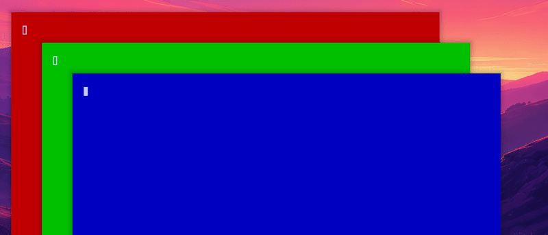

# omahop v1.3.1

A small change: the `modifier` setting no longer offers Super.

Super+Tab is Omarchy's own next-workspace key, and Omarchy uses most other Super chords. omahop should not sit on them, so the Super choice is gone. Two choices remain: `alt` (default) and `ctrl`. Ctrl+Alt is not an option either, because Omarchy binds Ctrl+Alt+Tab (focus next monitor). If your config says `modifier = "super"`, omahop uses Alt and logs it.

The gif shows the Ctrl choice: hold Ctrl, press Tab, the list opens, press Tab again to move down, release Ctrl to pick.

What was tested: unit and glue tests, the live modifier test (Ctrl opens the list and picks; Alt+Tab does not open it), and the full live suite.
