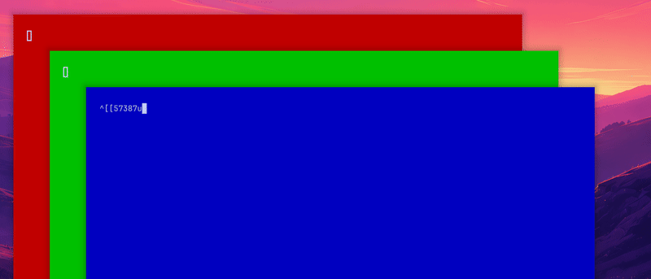

# omahop v1.4.0

Two things: search your browser tabs, and share an icon pack as one zip.

The gif shows tab search with made-up tabs: the search finds a hidden tab by its title and shows it under its window.

What is new:

- **Browser tabs (`browser_tabs`, off by default).** When on, typing in the switcher also searches every tab of a Chromium browser (Chrome, Chromium, Brave, Edge). A tab row shows the title and the site. Return focuses the browser window and switches to that tab. Tab rows show only while you type, so plain Alt+Tab stays as it is. `browser_tabs_ignore` hides sites you name (a bank, for example) before anything is written. Tab titles and addresses stay in the runtime folder (gone at logout), are never logged, and nothing is read when the setting is off. Needs a small extension and helper that live in a separate repository, `omahop-tabs`. That repository is private while it is tested, so you cannot install it yet. The omahop side is ready and tested with made-up tabs.
- **Share an icon pack as one zip.** `tools/pack-export.sh <name>` makes a zip. `tools/pack-import.sh <file.zip>` checks the whole archive before it unpacks anything (no paths outside the pack, no links, no scripts, size and entry limits), shows what it will add, and asks first. The commands and the rules are in `docs/icon-packs.md`.

All settings are in the settings window. Nothing new is added to your bar or desktop.

What was tested: unit and glue tests for every new part, shell tests for the tab helpers and for 18 hostile zip files, a live test of the tab search with a stand-in helper, and the full live suite (128 checks, no failures). Not tested yet: the extension in a visible Chrome (the window match by process id, focus), Brave, Edge.

Next ideas (not promised): publish the extension, a pack editor, profiles. See `docs/ROADMAP.md`.
