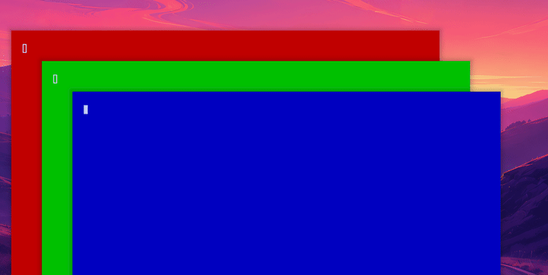

# omahop v1.5.0

Four optional features, all off or empty by default: named profiles, an audio marker, a touchpad swipe trigger and an icon pack editor.

The gif shows a profile at work: first the plain list, then, after the setting `profile = "work"`, the same Alt+Tab as cards with window pictures.

What is new:

- **Profiles.** Write a `[profiles.work]` table in `config.toml` with the settings you want to change, then choose it with the `profile` setting (a row in the settings window). A profile only changes what it names. Take over, Key to hold, the same-app shortcut and browser tabs are never changed by a profile. A bad value in a profile keeps your base value and is logged. The settings window switches profiles; the values themselves are written in the file for now.
- **Audio marker (`audio_marker`, off by default).** A small speaker after the app name of a window whose app plays sound. It looks at the sound once when the list opens, never in the background, and never keeps or logs titles. A browser with many windows marks all its windows, because one process plays all tabs.
- **Touchpad swipe (`swipe_trigger`, off by default).** A 3 or 4 finger swipe left or right opens the list, more travel moves the selection, lifting your fingers picks. Lift on the window you started from, or let it time out, to close without switching. Touchscreen swipes are not possible: Hyprland does not give them to plugins. Check `tools/gesture-map.lua` for the finger counts your config already uses.
- **Icon pack editor.** A page in the settings window (the button under Icon pack): make a pack, give an app an image, remove one, edit the author and licence, export a zip and import one. Every file goes through the same strict checks as the command line tools.

All settings are in the settings window. Nothing new is added to your bar or desktop.

What was tested: unit and glue tests for every new part, shell tests for the editor with 44 hostile inputs, a profile parity test (Lua and QML read the same rule), a matcher test for audio with made-up data (no real sound is ever played), and the full live suite (137 checks, no failures). Not tested yet, because they need a person: the swipe on a real touchpad, real sound in a browser, and clicking through the editor.

Next ideas (not promised): publishing the browser extension, a `trigger_key` setting. See `docs/ROADMAP.md`.
