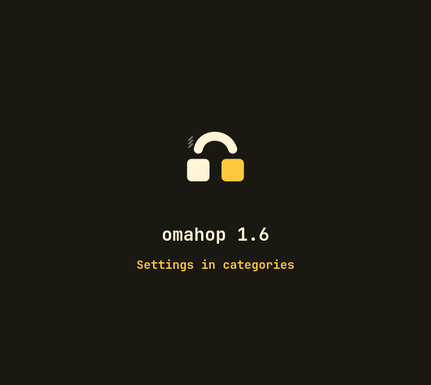
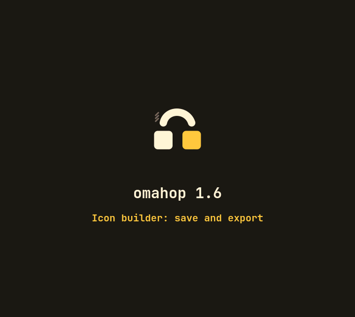

# omahop v1.6.0

A calmer settings window, a picker and a builder for icons, and an optional way to see your icons in the Omarchy launcher. Everything new is off or unchanged by default.

What is new:

- **Settings in categories.** The settings window is now a side list (General, Windows, Look, Keys, Peek strip, Browser tabs, Touchpad swipe) with one category shown at a time, sub headings, settings nested under the switch they need, and rarely used ones folded under "Show advanced settings".
- **Icon picker.** The Icon theme and Icon pack rows open a page with a card per choice, the same sample apps in each, so you compare side by side. Arrows preview, Enter chooses, Escape goes back.

- **Icon builder.** From the picker, Customize icons: pick an icon per app from any installed theme or from a file, see it in a real row and card, undo, then Save as pack, Export a zip or Import one. Packs you share never carry text that names your computer.

- **Themed packs and a reference pack.** A pack can set `follows_theme`, and omahop then regenerates it in the colours of the running Omarchy theme. `packs/omahop-reference` is a ready made one with 132 apps, and its omahop and omagnet entries are the real logos (they used to show the generic settings gear; the omahop launcher entry now uses the logo too).
- **Launcher icons (`icons_in_launcher`, off).** Shows your icon theme and pack in the Omarchy app grid, bar and menu rows, through one folder omahop owns (`~/.local/share/icons/omahop-launcher/`); turning it off deletes the folder. SVG icons only.
- **Browser tabs.** Found tabs show their site icon, and optionally a picture of the page (`browser_tab_previews`, with the omahop-tabs extension 0.8.0), with labels that say why a card has no picture. Window cards keep their last seen picture. A capital letter typed in the search types that letter.
- **Fixes.** Faster list and card drawing on the paths found in the performance pass, and a corrected README.

What was tested: the offline suite (`bash tests/run-all.sh --no-live`) and the scrub pass, with new tests for the picker, builder, export and import (including a privacy test), the launcher overlay and the reference pack. The settings window pages were checked by screenshots.

Known limits: the new settings categories, picker, builder and launcher icons were not hand tested with the keyboard before this release, except where Felipe did; hand checks are listed in `docs/validation-checklist.md`. Launcher icons take SVG only. The dock extension is not built (see `docs/ROADMAP.md`).

How to update: install as in the README (`omarchy plugin add https://github.com/felipecpaiva/omahop --enable`), then `omarchy restart shell` once.
